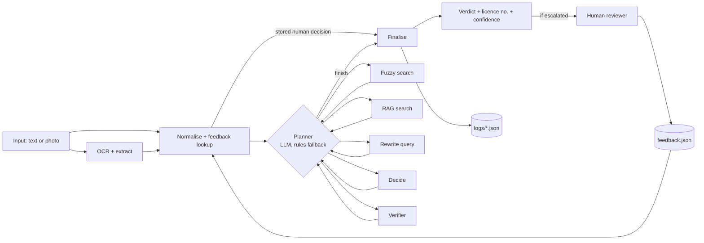

# CDSCO Licence Verification Agent

Type a manufacturer name and address. The agent checks it against the CDSCO licensed-manufacturer list and returns
**APPROVED / REJECTED / NEEDS HUMAN REVIEW**, the licence number, a confidence score and a visible reasoning trace.

Built with Python, LangGraph, Gemini, ChromaDB, RapidFuzz and Streamlit. No local GPU required.

> Advisory tool. A listing in the CDSCO file does not prove a licence is currently valid (many validity dates in the file have passed). Confirm with the licensing authority before any commercial or regulatory decision.

## Run it (5 steps)

1. **Setup** (Python 3.10+; PowerShell shown, use `source .venv/bin/activate` on Mac/Linux)
   ```
   python -m venv .venv
   .\.venv\Scripts\activate
   pip install -r requirements.txt
   ```
2. **Config:** `copy .env.example .env` (Mac/Linux: `cp`), then paste your `GEMINI_API_KEY` (free key: aistudio.google.com/apikey).
   No key? Leave it blank: the agent still runs on the rule-based policy, without the Gemini planner and verifier.
   Also set `EMBED_BACKEND=fake` in that case, because real embeddings need a key.
3. **Parse the data** (must be `.docx`; if you have `.doc`, open in Word and Save As `.docx`)
   ```
   python ingest.py ../CDSCO_Drug_License_holder_data.docx
   ```
   Writes `data/records.csv` (name, address, license_no, state, category) and `data/parse_errors.csv`.
4. **Build the vector index** (once)
   ```
   python rag.py
   ```
   If Gemini embeddings are busy or rate-limited, set `EMBED_BACKEND=fake` in `.env` and rerun. It uses an offline
   character-trigram embedder. Use the same setting for building and searching.
5. **Launch the app**
   ```
   streamlit run app.py
   ```
   Enter a name and address (include the 6-digit PIN for best accuracy) and click Verify. Each agent step appears live.

Run tests any time: `pytest -q` (32 tests, fully offline; the planner tests use a scripted fake LLM).

## Evaluation, feedback, OCR

```
python evaluate.py --n 12                    # builds data/eval_cases.csv (4 kinds x 12), compares fuzzy-only / RAG-only / agent
python evaluate.py --sweep                   # grid over ambiguous/approve thresholds, best (lowest false-approval) first
python evaluate.py --feedback-demo           # same cases before/after simulated human resolutions
python evaluate.py --llm                     # include Gemini planner + verifier (slower, uses quota)
```
Writes `eval_report.md`. Edit or add rows in `data/eval_cases.csv`; it is reused on later runs. Delete it to regenerate.

- **Feedback:** in the app, NEEDS HUMAN REVIEW results show Approve / Not-listed buttons. Decisions are saved to `data/feedback.json` and checked first on every run.
- **Photo:** `Photo` tab. EasyOCR by default (`OCR_ENGINE=tesseract` to use Tesseract). Low confidence (< 0.6) triggers a preprocessing retry, then asks for a clearer image.
- **Validity:** if `records.csv` has a `valid_upto` column the agent warns when it is in the past. Otherwise every result carries a note that a listing does not prove current validity.

## How the agent decides (`agent.py`, LangGraph)



`normalize -> [ planner -> tool ]* -> finalize`, where the tool is one of: fuzzy search, RAG search, rewrite query, decide, verify.

- **The LLM is the planner.** After every step Gemini sees the query, what has been done, the top candidates and the actions
  currently allowed, and picks the next one with a one-sentence reason (shown live in the app and saved in `logs/`).
- **Guardrails.** It can only pick allowed actions (e.g. no `finish` before `decide`), it gets at most `MAX_STEPS` (8) choices,
  and it never gives the verdict: the deterministic `decide` tool does, so the LLM cannot approve a wrong-city match.
- **Fallback.** No API key, a Gemini error, or an invalid choice: the rule-based policy (`rules_next`, the original fixed graph)
  takes over for that step. The trace marks each step `by: llm` or `by: rules`.
- **Hybrid retrieval.** Fuzzy matching (RapidFuzz) plus semantic search (Chroma). Candidates are scored on the name only, so a real address cannot lift a fabricated firm.
- **Query rewriting.** Weak results trigger a retry: drop generic words, name + address, or search by PIN (max 3).
- **Verifier.** Checks that the best candidate is the same legal entity at the same place. It can overturn an approval and send the agent back for another attempt (max 2 runs).
- **Decision rule.** `APPROVED` needs a direct match, name score ≥ 90 and consistent address/PIN. Otherwise score ≥ 70 gives `NEEDS HUMAN REVIEW`, below 70 gives `REJECTED`. Same name in a different city/PIN is never approved. Name-only input is never approved.
- **Feedback loop.** Human decisions from the app are checked first on every run.

Compare modes: `python evaluate.py --llm` adds an `agent_llm_planner` row next to the rule-based `agent` row.
Run the planner offline with `planner="rules"` (the default when there is no key or "Use Gemini" is off).

## Configuration (`.env`)

| Variable | Purpose |
|---|---|
| `GEMINI_API_KEY`, `GEMINI_API_KEY2`, ... | API keys, tried in order (only keys from separate projects add quota) |
| `GEMINI_MODEL`, `GEMINI_FALLBACK` | Primary and fallback model IDs |
| `GEMINI_MODELS` | Optional comma-separated list that overrides the two above |
| `GEMINI_MIN_GAP` | Seconds between calls to one model (default `13`, for a 5 RPM free tier) |
| `EMBED_BACKEND` | empty = Gemini embeddings; `fake` = offline trigram embedder |
| `OCR_ENGINE` | `easyocr` (default) or `tesseract` |

`gem.py` rotates across keys and models, paces calls, waits out per-minute 429s, drops a model after a per-day 429, and times out after 30 s. Never commit `.env`.

## Results

48 synthetic cases (4 kinds x 12, seed 7), verifier off, rule-based planner:

| Metric | Fuzzy only | RAG only | Agent |
|---|---|---|---|
| Accuracy | 0.583 | 0.500 | 0.625 |
| **False approval rate** | 0.000 | 0.000 | **0.000** |
| Approved recall | 0.875 | 0.000 | 0.958 |
| Escalation rate | 0.417 | 0.021 | 0.375 |
| Mean tool calls | 1.00 | 1.00 | 2.44 |
| Mean latency (s) | 0.17 | 1.28 | 1.62 |

Accuracy is low because the harness counts every escalation (`NEEDS HUMAN REVIEW`) as wrong, including near-misses where escalation is the intended safe outcome.

**Caveats.** Cases are synthetic and derived from the same list the agent searches; labels are not human-checked; n is small. RAG-only retrieval returned the source record in the top 5 for 0 of 24 positives, which suggests an undiagnosed index problem. The LLM planner has been inspected through traces only and not evaluated at scale (free-tier quota).

## Repository structure

```
ingest.py       Word document -> data/records.csv, parse_errors.csv
backend.py      normalisation, scoring, location check, verifier call
rag.py          Chroma index build and search
agent.py        LangGraph graph, planner, tools, guardrails, tracing
gem.py          Gemini call: key/model rotation, pacing, timeout
feedback.py     human-decision store (checked first on every run)
ocr.py          OCR with preprocessing retry, query extraction
app.py          Streamlit UI
evaluate.py     case generation, baselines, metrics, sweep, feedback demo
test_*.py       offline tests
data/           records.csv, chroma/, feedback.json, eval_cases.csv
logs/           one JSON trace per run
```

## Known limitations

- A PIN written with a space (e.g. `387 411`) is not parsed by the location check.
- A rewrite replaces the candidate list, which can discard an earlier good match.
- Thresholds (90 / 70) are not tuned.
- The OCR extraction call does not use the `gem.py` rotation layer.
- About 981 parsed records have no licence number; 3,442 unparsed rows were not audited.
- Dependencies are not version-pinned. Run `pip freeze > requirements.lock` before release.

## Data

Licence data: Central Drugs Standard Control Organisation (CDSCO), [Data Bank](https://cdsco.gov.in/opencms/opencms/en/Data-Bank/Data-Bank-Sub-cat/). The data is not redistributed in this repository.

## License

MIT License.
